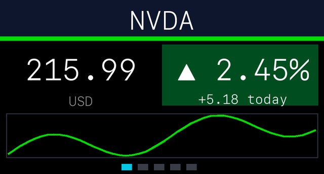

# 📈 Desk Stock Ticker (ESP32-C6)

A tiny Wi-Fi desk gadget that shows live stock prices on a bright color LCD.
It rotates through your favorite tickers, shows the day's change and an
intraday trend chart, and even tracks **pre-market / after-hours** prices.

No soldering, no coding, no subscription. Prices come straight from Yahoo
Finance (no API key needed). Everything is configured from a simple web page
on your phone.



---

## ✨ Features

- **Live prices** for any US stocks/ETFs (AAPL, NVDA, SPY, …)
- **Auto-rotates** through your watchlist
- **Day change** in % and $, color-coded green/red
- **Intraday trend chart** (sparkline) for each stock
- **Pre-market & after-hours** prices, with slower polling when the market is closed (easy on your network)
- **Portrait or landscape** — pick in the settings
- **Custom boot title** — put a name on it ("DAD'S TICKER")
- **Touch-free dimming** — screen dims after a while; tap the **BOOT** button to wake / open settings
- **Phone setup** — no computer needed after the first flash

---

## 🛒 What you need (hardware)

Just one board and a cable. Total cost is usually **under $20**.

| Item | Why | Buy |
|------|-----|-----|
| **Waveshare ESP32-C6-LCD-1.47** | The brains + the 1.47" color screen, all in one. Get the **non-touch** version. | [Amazon](https://www.amazon.com/s?k=Waveshare+ESP32-C6-LCD-1.47&tag=stockticker-20) |
| **USB-A to USB-C cable** | Powers the board and flashes it. ⚠️ Use an **A-to-C** cable — some plain C-to-C cables won't power this board. | [Amazon](https://www.amazon.com/s?k=USB-A+to+USB-C+cable&tag=stockticker-20) |
| **5V USB power adapter** *(optional)* | Any phone charger or a PC USB port works. | [Amazon](https://www.amazon.com/s?k=5V+USB+wall+charger&tag=stockticker-20) |

> 💡 *The links above are Amazon affiliate links. If you publish your own copy,
> replace `stockticker-20` with **your** Amazon Associates tag (or remove it).*

---

## 🚀 Quick start

### Already flashed? (e.g. you received this as a gift)

1. Plug the board into any USB power (phone charger, laptop, power bank).
2. It shows a title screen, then says **"SETUP"** with a Wi-Fi name.
3. On your phone, join the Wi-Fi network:
   - **Network:** `StockTicker-Setup`
   - **Password:** `ticker123`
4. A setup page should pop up automatically. If not, open a browser to
   **http://192.168.4.1**
5. Enter your home **Wi-Fi name + password**, pick your **stocks**, tap **Save**.
6. The device reboots and starts showing live prices. 🎉

That's it — you never need a computer.

---

## 🔧 First-time flashing (one time, needs a computer)

Only needed if you're building one from a blank board. If your board already
runs the ticker, skip this.

**Requirements:** a Mac/Linux/Windows computer with Python 3 and the USB cable.

```bash
git clone https://github.com/dcluomax/stock-ticker-esp32c6.git
cd stock-ticker-esp32c6

# plug the board in, then run (edit the port if needed):
./flash.sh /dev/cu.usbmodem*        # macOS
# ./flash.sh /dev/ttyACM0           # Linux
```

`flash.sh` will:
1. install the host tools (`esptool`, `mpremote`),
2. download the MicroPython firmware for the ESP32-C6,
3. erase + flash the board,
4. download the display driver + fonts,
5. copy the app (`main.py`, `config.json`) onto the board.

Reset the board when it finishes. It boots straight into the setup flow above.

<details>
<summary>Windows / manual notes</summary>

On Windows, find the COM port in Device Manager (e.g. `COM5`) and run the
`esptool`/`mpremote` commands from `flash.sh` by hand, replacing the port. You
need [Python 3](https://www.python.org/downloads/) installed first.
</details>

---

## ⚙️ Settings (the web page)

Open the config page any time:

- **During setup:** join `StockTicker-Setup` → http://192.168.4.1
- **After it's online:** tap the **BOOT** button twice (once to wake, once for
  the CONFIG screen) — it shows the device's IP address. Type that IP into a
  browser on the same Wi-Fi.

| Setting | What it does |
|---------|--------------|
| **Wi-Fi name / password** | Your home network |
| **Tickers** | Comma-separated symbols, e.g. `AAPL,NVDA,SPY,BTC-USD` |
| **Boot title / subtitle** | Text on the startup screen (English/numbers only) |
| **Splash seconds** | How long the title shows (0 = skip) |
| **Rotate delay** | Seconds each stock stays on screen |
| **Refresh interval** | How often prices update while the market is open |
| **Closed-market refresh** | Slower update rate when the market is closed |
| **Screen orientation** | Portrait or Landscape (and flipped versions) |
| **Brightness** | 0–100% |
| **Dim after / Dim brightness** | Auto-dim the screen after inactivity |

Tap **Save & Reboot** to apply.

---

## 🕹️ Using the button

The device has one button labeled **BOOT**:

- **Tap once** when the screen is dim → wakes it to full brightness
- **Tap again** → opens the **CONFIG** screen (shows the IP to edit settings)
- **Tap once more** → back to scrolling stocks

The screen auto-dims after a few minutes to save power and screen life.

---

## ❓ Troubleshooting

| Problem | Fix |
|---------|-----|
| **Screen is black / won't turn on** | Use an **USB-A → USB-C** cable. Some C-to-C cables don't deliver power to this board. Try a different USB port or charger. |
| **Stuck on "SETUP"** | It can't reach your Wi-Fi. Re-join `StockTicker-Setup`, open http://192.168.4.1, and re-enter your Wi-Fi name/password (case-sensitive). 2.4GHz networks work best. |
| **"no data" on a stock** | Check the symbol is a valid Yahoo Finance ticker (e.g. `BRK-B`, not `BRK.B`). |
| **Setup page won't load** | Make sure your phone stayed on the `StockTicker-Setup` Wi-Fi (turn off mobile data), then browse to http://192.168.4.1 manually. |
| **Want to start over** | Re-run `./flash.sh` to reflash, or push a fresh `config.json` (see below). |

### Edit config from a computer (optional)

```bash
# pull the current config off the board
mpremote connect /dev/cu.usbmodem* fs cp :config.json config.json
# ...edit it...
# push it back
mpremote connect /dev/cu.usbmodem* fs cp config.json :config.json
# watch the logs
mpremote connect /dev/cu.usbmodem* repl
```

---

## 🧩 How it works

- **`main.py`** — the whole app (MicroPython): Wi-Fi, web config + captive
  portal, Yahoo Finance fetch, the display/UI, button state machine.
- **`config.json`** — your settings (also editable from the web page).
- **`lib/`** — the [`st7789py`](https://github.com/russhughes/st7789py_mpy)
  display driver + bitmap fonts.
- **`flash.sh`** — one-shot flashing helper.

Prices use Yahoo Finance's public chart endpoint
(`v8/finance/chart`, `includePrePost=true`) — no account or API key required.

---

## 📜 Notes & credits

- Display driver: [russhughes/st7789py_mpy](https://github.com/russhughes/st7789py_mpy) (MIT).
- Runtime: [MicroPython](https://micropython.org/) for ESP32-C6.
- Stock data: Yahoo Finance public endpoints. This project is for personal,
  hobby use and is **not** affiliated with Yahoo. Prices may be delayed.
- **Not financial advice.** For fun and glanceable info only.

## License

MIT — see [LICENSE](LICENSE). Do whatever you like; no warranty.
